  <a href="https://www.linkedin.com/in/tiago-iesbick"><b>LinkedIn</b></a>
  &nbsp;·&nbsp;
  <a href="mailto:tiagoiesbick@gmail.com"><b>tiagoiesbick@gmail.com</b></a>
  &nbsp;·&nbsp;
  Porto Alegre, Brazil (UTC-3)
  &nbsp;·&nbsp;
  Open to senior remote roles

I lead technology at a public pension fund in Brazil, where I replace legacy systems and put AI agents into real operations. Before engineering full-time, I managed a R$1.3B investment portfolio as Chief Investment Economist, so I write software with budgets, risk and compliance in mind.

### In production

Most of my work runs inside organizations and is not on GitHub.

- **Payroll integration.** Cut payroll processing for about 30,000 employees from hours to seconds, with Python middleware between legacy HR and accounting systems. `Python` `Docker` `GCP Cloud Run` `pytest`
- **AI pension assistant.** Real-time conversational assistant for 30,000+ pension fund members, with streaming answers grounded in legislation. `GraphQL subscriptions` `WebSockets` `Redis Pub/Sub` `React`
- **[UXO Grocery](https://uxo.hk).** E-commerce platform for a Hong Kong grocery brand, designed, built and deployed remotely from Brazil. `Django` `AWS` `Stripe` `Docker` `GitHub Actions`

### Open source

The repositories pinned below are my own. I also have three projects merged into [ed-donner/agents](https://github.com/ed-donner/agents/pulls?q=is%3Apr+author%3ATiagoIesbick+is%3Amerged), the companion repository of a widely followed agentic AI course.

### Stack

**AI** &nbsp; `Claude Agent SDK` `MCP` `LangGraph` `OpenAI Agents SDK` `CrewAI` 
**Backend** &nbsp; `Python` `Django` `FastAPI` `GraphQL` `Node.js` 
**Frontend** &nbsp; `TypeScript` `React` `Next.js` 
**Data** &nbsp; `PostgreSQL` `Oracle` `SQL Server` `Redis` `Elasticsearch` `pandas` 
**Infra** &nbsp; `Docker` `AWS` `GCP` `GitHub Actions`
